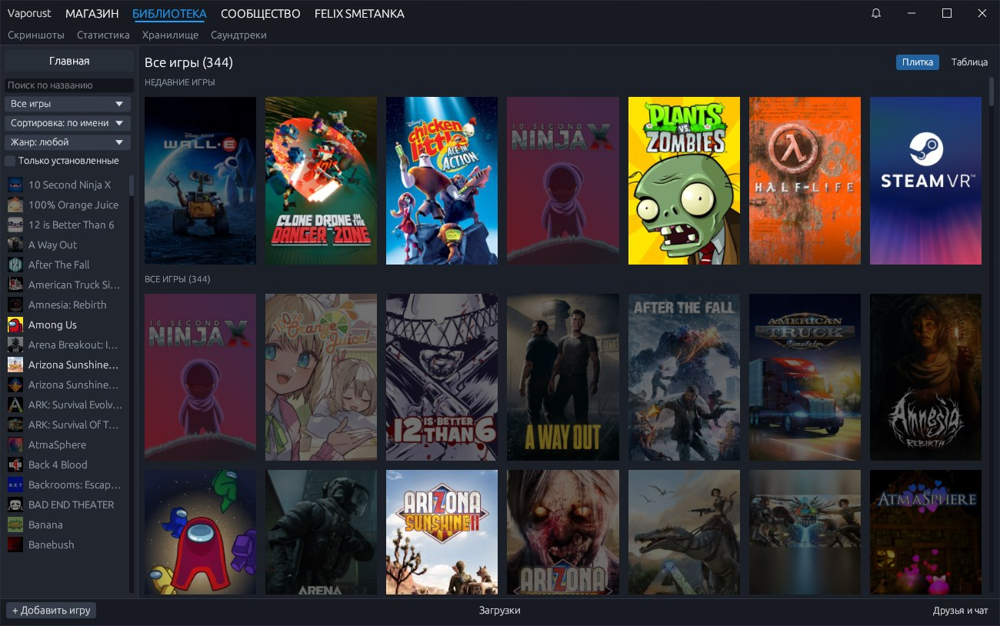
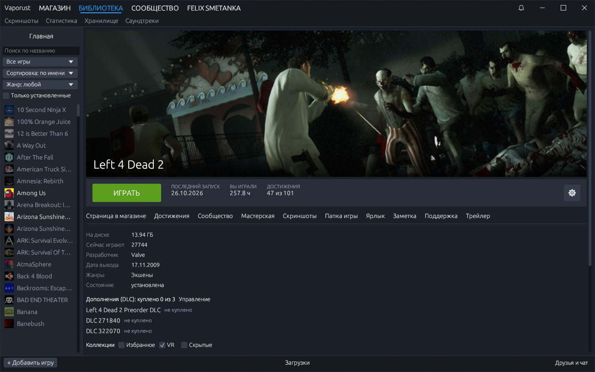
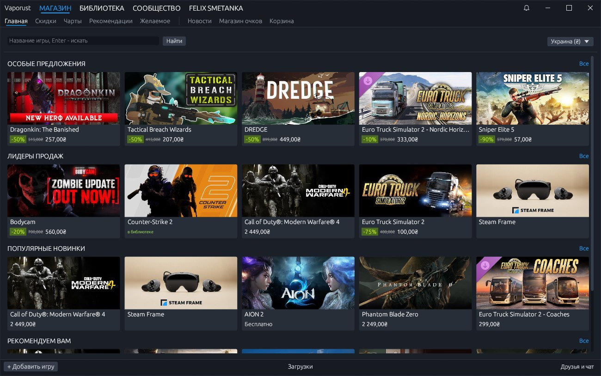
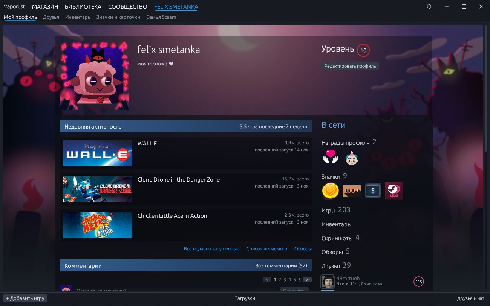

<p align="center"></p>

<h1 align="center">Vaporust</h1>

<p align="center">
  Библиотека, магазин, друзья и чат в легком окне на 30-80 МБ памяти - для слабых компьютеров.<br>
  Игры при этом запускаются через настоящий Steam - достижения и облако работают как обычно.
</p>

<p align="center">
  <a href="../../releases/latest"><b>Скачать для Windows</b></a> ·
  <a href="#что-умеет">Возможности</a> ·
  <a href="#вопросы">Вопросы</a> ·
  <a href="ROADMAP.md">Планы</a> ·
  <a href="#english">English</a>
</p>

<p align="center">
  <a href="LICENSE"></a>
  
  
  
</p>

<p align="center"></p>

<table>
  <tr>
    <td width="33%"></td>
    <td width="33%"></td>
    <td width="33%"></td>
  </tr>
  <tr>
    <td align="center">Страница игры</td>
    <td align="center">Магазин</td>
    <td align="center">Профиль</td>
  </tr>
</table>

> [!WARNING]
> **Неофициальный проект**, не связан с Valve и Steam. Vaporust меняет файлы Steam и работает с
> сетью Steam не через официальный клиент; программа предоставляется «как есть», без гарантий.
> Используйте на свой страх и риск. Подробно - в разделе [«Отказ от ответственности»](#отказ-от-ответственности).

---

## Зачем

Официальный клиент Steam построен на встроенном браузере: один только steamwebhelper легко
занимает сотни мегабайт, и на старом ноутбуке все тормозит еще до запуска игры. Vaporust
рисует тот же привычный интерфейс сам, без браузера, а Steam поднимает незаметно и только на
время игры.

|   | Обычный Steam | **Vaporust** |
|---|---|---|
| Память в покое | сотни МБ | **30-80 МБ** |
| Во время игры | клиент + steamwebhelper | Steam в фоне, steamwebhelper заморожен и не занимает оперативную память, остальное 10-20 МБ |
| Установка и обновление игр | через клиент | **без запуска Steam** |
| Смена языка и беты | через клиент | **без запуска Steam** |
| Запуск игр | Steam | через скрытый Steam; игры без защиты - вообще без Steam |
| Открытый код | нет | да, GPL-3.0 |

Название - от *vapor* (пар) + *Rust*.

## Что умеет

**Игры**
- Купленные, установленные и **семейные** игры Steam, плиткой обложек или таблицей; коллекции,
  поиск, жанры, полки «Недавние игры» и «Что нового».
- «ИГРАТЬ»: Steam стартует скрыто и закрывается после игры. Игры без защиты - напрямую.
- Свойства как в Steam: параметры запуска, язык, беты, **откат и закрепление версии**, проверка
  файлов, перенос, DLC, облако, Мастерская. Сторонние игры, ярлыки, скрипты до и после запуска.

**Загрузки**
- Установка и обновление без Steam: очередь с паузой, ограничение скорости, расписание
  («качать ночью»), регион загрузки, продолжение после обрыва связи.

**Друзья и чат**
- Статусы и игры друзей, заявки, профили. Чат с вкладками, историей, поиском, смайликами,
  анимированными стикерами, картинками (в том числе Ctrl+V), реакциями и эффектами комнаты.
- Свои легкие всплывающие уведомления: сообщение, друг зашел в игру, скидка в желаемом.

**Магазин и сообщество**
- Главная с полками, скидки, чарты, список желаемого, отзывы, системные требования, корзина.
- Профиль как в Steam, обсуждения и руководства, Мастерская с модами и коллекциями, скриншоты,
  значки и карточки, магазин очков, семья Steam.
- Инвентарь и торговая площадка: цены, график, **быстрая и мгновенная продажа**, обмены.

**Для слабых компьютеров**
- «Настройки -> Производительность»: без анимаций и обложек, экономия памяти, отдавать память
  системе в трее и во время игры. Проверено на ThinkPad E330 с графикой Intel: около 30 МБ.

**Удобство и безопасность**
- Несколько аккаунтов, трей, автозапуск, масштаб 75-200%, мастер первого запуска.
- Сохраненный вход зашифрован ключом Windows (если хранилище ключей недоступно, Vaporust об этом
  предупредит); обновления Vaporust ставятся одной кнопкой и
  проверяются по контрольной сумме.

## Установка

1. Нужен **Windows 10 или 11** и установленный **Steam**, в который хоть раз входили с галочкой
   «Запомнить пароль».
2. Скачайте архив со страницы [Releases](../../releases/latest): `windows-x64` для обычной
   Windows, `windows-x86` для 32-битной.
3. Распакуйте в любую папку и запустите `vaporust.exe`. Установка не нужна.
4. Войдите в аккаунт Steam: пароль и код Steam Guard или QR-код из приложения Steam.

Дальше Vaporust обновляется сам: сверху появится «Доступна новая версия».

## Что проверено

Vaporust в **альфе**. Все основное проверено вручную на двух компьютерах с Windows 10, включая
старый ноутбук, но ошибки вполне вероятны.

- **Проверено мало:** продажа на площадке и обмены, откат версии игры, ручная синхронизация
  облака, работа без интернета, публичные действия в сообществе (комментарии, оценки, вступление
  в группы, блокировка). Если что-то не так - [напишите](../../issues).
- **Пока нет:** закрытые беты с паролем (включаются в самом Steam), английский интерфейс
  (будет в бете).
- **Автоматические тесты** на каждой сборке: разбор страниц Steam на сохраненных примерах;
  поведение при испорченных файлах Steam и битых архивах (ничего не портится и не удаляется);
  восстановление сохранений «все или ничего»; расчет места на диске и решение, продолжать ли
  загрузку после ошибки сети. Настоящий обрыв связи посреди загрузки тестами пока не моделируется.

Что дальше - в [ROADMAP.md](ROADMAP.md).

## Вопросы

<details>
<summary><b>Нужен ли официальный Steam?</b></summary>

Для большинства игр - да. Vaporust сознательно запускает игры через настоящий Steam, чтобы
работали достижения, облако, защита от копирования и учет времени. Клиент открывается
незаметно и только на время игры. Игры без защиты можно запускать напрямую (галочка «Запускать
без Steam» в свойствах игры) - тогда Steam не нужен, но нет достижений и облака.
</details>

<details>
<summary><b>Сколько памяти занимает?</b></summary>

Сам Vaporust - около 30-80 МБ в Диспетчере задач, в зависимости от компьютера и открытых
разделов (на ПК с NVIDIA около 34 МБ из этого - драйвер видеокарты). В трее и во время игры он
отдает память системе. Пока идет игра, работает и Steam. Его steamwebhelper (самая тяжелая
часть) Vaporust приостанавливает и выгружает из оперативной памяти: в Диспетчере задач он
показывает 0 МБ. Данные при этом не исчезают, а уходят в файл подкачки на диске и возвращаются,
когда игра закрыта. Остальные части Steam во время игры занимают около 10-20 МБ.
</details>

<details>
<summary><b>Могут ли заблокировать аккаунт?</b></summary>

Vaporust неофициальный и сам меняет файлы Steam. Любые сторонние программы, работающие со
Steam, несут такой риск. Игры при этом запускает настоящий Steam, а в процессы игр Vaporust не
встраивается. Решение за вами - см. [отказ от ответственности](#отказ-от-ответственности).
</details>

<details>
<summary><b>Работает ли на 32-битной Windows, Windows 7, Linux, macOS?</b></summary>

32-битная Windows - да, есть архив `windows-x86`. Но сам Steam с 1 января 2026 года ее не
поддерживает, поэтому там надежно работают магазин, друзья, чат, установка игр и запуск игр без
Steam. Windows 7, Linux и macOS - нет. На Linux попробуйте [Aurelia](https://github.com/Drackrath/Aurelia).
</details>

<details>
<summary><b>Чем отличается от Aurelia?</b></summary>

[Aurelia](https://github.com/Drackrath/Aurelia) - консольный клиент Steam, в первую очередь для
Linux. Vaporust - оконный лаунчер для Windows, построенный на ней: работа с сетью Steam - от
Aurelia, интерфейс и все остальное - свое.
</details>

## Как это устроено

- **Сеть Steam** (вход, загрузки, друзья, чат) - библиотека [Aurelia](https://github.com/Drackrath/Aurelia),
  ее измененная копия лежит в `vendor/aurelia` (версия 0.2.5), изменения перечислены в
  [`VAPORUST_CHANGES.md`](vendor/aurelia/VAPORUST_CHANGES.md).
- **Интерфейс** - [egui](https://github.com/emilk/egui), без браузера.
- **Запуск** - настоящий Steam с флагами `-silent -no-browser`; Vaporust следит за процессами и
  закрывает Steam после игры.
- **Обновление, язык, бета** - файлы качает Vaporust, а в файл игры (appmanifest) вписывает
  только новые версии, остальное остается как у Steam, поэтому Steam считает игру обновленной.
- **Закрепление версии** - в файл игры пишутся последние версии, а настоящие хранятся у
  Vaporust: Steam не трогает игру, открепление все возвращает.
- **Параметры запуска** хранятся там же, где у Steam (`localconfig.vdf`), и видны в клиенте.

## Сборка из исходников

Нужен [Rust](https://rustup.rs/) (проверено на 1.90) и Microsoft C++ Build Tools.

```bash
git clone https://github.com/felixsmtnk/Vaporust.git
cd Vaporust
cargo build --release
```

Программа появится в `target\release\vaporust.exe`. Для 32-битной версии нужен еще
[NASM](https://www.nasm.us/) в `PATH` и стандарт C11:

```bash
rustup target add i686-pc-windows-msvc
set AWS_LC_SYS_C_STD=11
set CFLAGS_i686_pc_windows_msvc=/std:c11
cargo build --release --target i686-pc-windows-msvc
```

Обе версии собирает GitHub Actions ([`build.yml`](.github/workflows/build.yml)) и прикладывает
архивы к черновику релиза для меток `v*`.

## Благодарности

Vaporust вдохновлен **[Aurelia](https://github.com/Drackrath/Aurelia)** и построен на ее коде:
вход в Steam, загрузка игр, достижения, друзья и чат - работа ее автора, **Drackrath**.
Огромное спасибо, без Aurelia этого проекта бы не было.

Aurelia выросла из **[SteamFlow](https://github.com/weter11/SteamFlow)** и стоит на
**[steam-vent](https://codeberg.org/steam-vent/steam-vent)**, где проделана огромная работа по
разбору протокола Steam. Спасибо и **[OpenSteamClient](https://github.com/OpenSteamClient/OpenSteamClient)**
(Rosentti и участники) - он показал, что открытый клиент Steam - реальная задача.

<details>
<summary>Все использованные проекты</summary>

- [Aurelia](https://github.com/Drackrath/Aurelia) - консольный клиент Steam на Rust, основа Vaporust
- [SteamFlow](https://github.com/weter11/SteamFlow) - проект, из которого выросла Aurelia
- [steam-vent](https://codeberg.org/steam-vent/steam-vent) и [steam-vent-chat](https://codeberg.org/steam-vent/chat) (в Aurelia - форк [aurelia-steam-vent-chat](https://codeberg.org/Drackrath/aurelia-steam-vent-chat)) - протокол Steam и чата
- [steam-cdn](https://github.com/OccamyLab/steam-cdn) (в Aurelia - форк [aurelia-steam-cdn](https://github.com/Drackrath/aurelia-steam-cdn)) - загрузка игр
- [egui / eframe](https://github.com/emilk/egui), [ehttp](https://github.com/emilk/ehttp) - интерфейс и загрузка картинок
- [tokio](https://tokio.rs/), [sysinfo](https://github.com/GuillaumeGomez/sysinfo), [winreg](https://github.com/gentoo90/winreg-rs), [windows-sys](https://github.com/microsoft/windows-rs), [image](https://github.com/image-rs/image), [arboard](https://github.com/1Password/arboard), [rfd](https://github.com/PolyMeilex/rfd), [chrono](https://github.com/chronotope/chrono), [qrcode](https://github.com/kennytm/qrcode-rust), [zip](https://github.com/zip-rs/zip2)
- [SteamDatabase/Protobufs](https://github.com/SteamDatabase/Protobufs), [SteamKit2](https://github.com/SteamRE/SteamKit), [node-steamcommunity](https://github.com/DoctorMcKay/node-steamcommunity), [node-steam-user](https://github.com/DoctorMcKay/node-steam-user) - описания протоколов и сайта Steam
- Похожие проекты: [OpenSteamClient](https://github.com/OpenSteamClient/OpenSteamClient), [SteamCMD](https://developer.valvesoftware.com/wiki/SteamCMD)
</details>

## Отказ от ответственности

- Vaporust - **независимый неофициальный проект**. Он **не связан с Valve Corporation и Steam**,
  не одобрен, не спонсируется и не поддерживается ими.
- «Steam», «Valve», логотипы Steam и названия игр - товарные знаки и собственность Valve
  Corporation и соответствующих правообладателей.
- Программа **напрямую меняет файлы Steam** (настройки запуска, файлы игр) и работает с сетью
  Steam не через официальный клиент. Это может повредить установку Steam или игры, а Valve
  может ограничить аккаунт за использование неофициальных программ.
- Программа предоставляется **«как есть», без каких-либо гарантий**. Авторы **не несут
  ответственности** за последствия ее использования: потерю данных, повреждение установки,
  блокировку аккаунта и т. п.

## Лицензия

[GPL-3.0-or-later](LICENSE), как и у Aurelia. История лицензии Aurelia - в
[`vendor/aurelia/LICENSE`](vendor/aurelia/LICENSE).

---

## English

**Vaporust** (*vapor* + *Rust*) is a lightweight Steam client for Windows: library, store,
friends and chat in a native [egui](https://github.com/emilk/egui) window that uses about
30-80 MB of RAM - no embedded browser. Games still run through the **real Steam client**,
started hidden and closed with the game, so achievements and cloud saves work as usual
(steamwebhelper is suspended while you play and paged out of RAM).

- Install, update and switch language or beta **without starting Steam**; download queue,
  speed limit and schedule; version rollback and pinning; DRM-free games run without Steam.
- Family Sharing library, collections, game properties, achievements, screenshots, non-Steam games.
- Friends and chat with emoticons, animated stickers, images, reactions and room effects.
- Store with reviews and wishlist, Steam-like profile, discussions, Workshop, inventory and
  Community Market with quick and instant sell.
- Encrypted saved login, checksum-verified self-update, multiple accounts, 64- and 32-bit builds.
- Networking by a lightly modified copy of **[Aurelia](https://github.com/Drackrath/Aurelia)**
  by Drackrath - huge thanks.
- **Status: alpha (0.6.1-alpha).** The interface is in Russian for now; English is planned for the beta.

**Disclaimer:** an independent, unofficial project, **not affiliated with, endorsed or sponsored
by Valve Corporation or Steam**. Steam and Valve are trademarks of Valve Corporation. The
software modifies Steam's files and is provided **"as is", without any warranty**; the authors
are **not liable** for any consequences of its use, including data loss, broken installations
or account restrictions. Use at your own risk.

License: [GPL-3.0-or-later](LICENSE).
