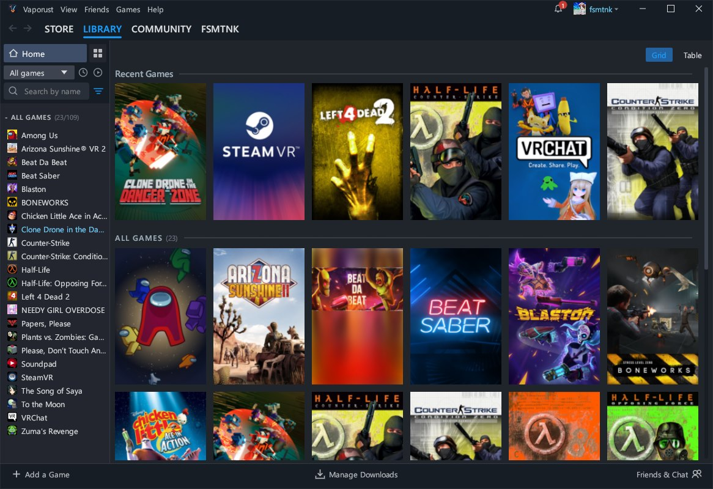
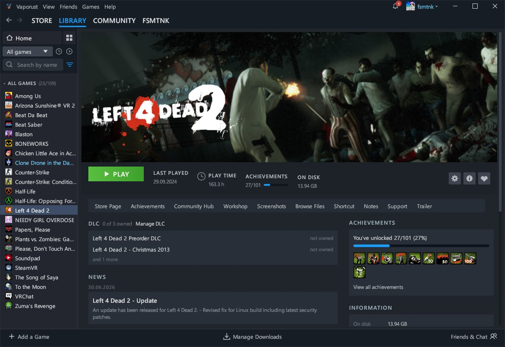
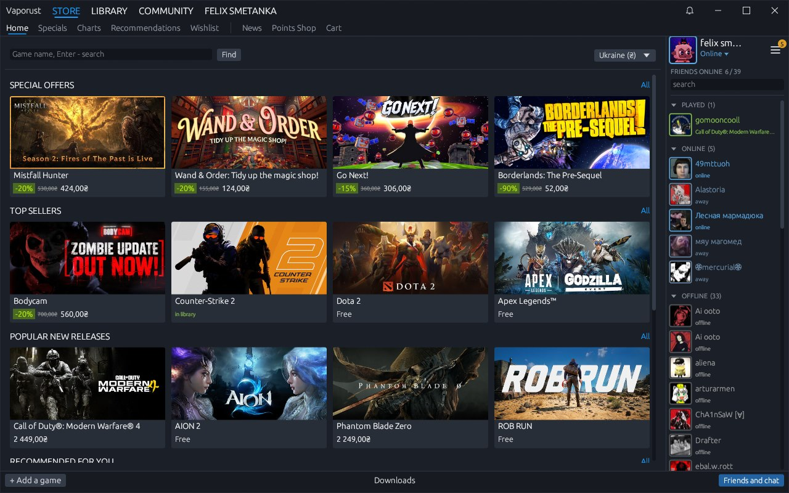
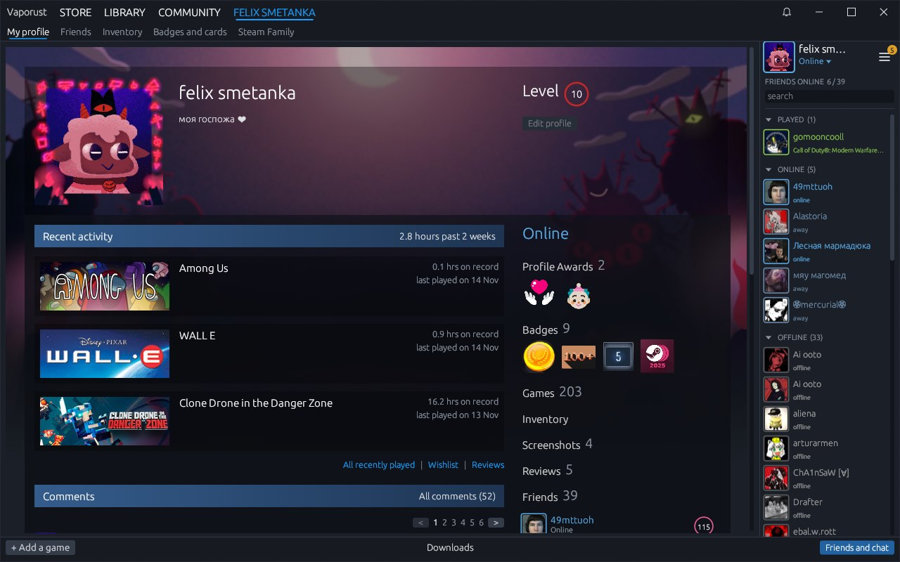

<p align="center"></p>

<h1 align="center">Vaporust</h1>

<p align="center">
  Your Steam library, store, friends and chat in a light window using 30-80 MB of RAM - made for weak PCs.<br>
  Games still run through the real Steam, so achievements and cloud saves work as usual.
</p>

<p align="center">
  <a href="../../releases/tag/v0.8.5-alpha"><b>Download for Windows</b></a> ·
  <a href="#password-and-security">Password and security</a> ·
  <a href="#features">Features</a> ·
  <a href="#faq">FAQ</a> ·
  <a href="ROADMAP.md">Roadmap</a> ·
  <a href="README.ru.md">Русский</a>
</p>

<p align="center">
  <a href="LICENSE"></a>
  
  
  
</p>

<p align="center"></p>

<table>
  <tr>
    <td width="33%"></td>
    <td width="33%"></td>
    <td width="33%"></td>
  </tr>
  <tr>
    <td align="center">Game page</td>
    <td align="center">Store</td>
    <td align="center">Profile</td>
  </tr>
</table>

> [!WARNING]
> **An unofficial project**, not affiliated with Valve or Steam. Vaporust changes Steam files and
> talks to the Steam network without the official client; it is provided "as is", without any
> warranty. Use it at your own risk. Details - in the [Disclaimer](#disclaimer).

The interface is available in **English and Russian** (Settings -> Window -> Interface language;
by default it follows the Windows language).

---

## Why

The official Steam client is built on an embedded browser: steamwebhelper alone easily takes
hundreds of megabytes, and an old laptop slows down before the game even starts. Vaporust draws
the same familiar interface itself, without a browser, and starts Steam unnoticed and only for
the time you play.

|   | Regular Steam | **Vaporust** |
|---|---|---|
| Memory when idle* | hundreds of MB | **30-80 MB** for Vaporust itself; Steam is not running |
| While playing | client + steamwebhelper | Steam in the background: steamwebhelper is frozen and paged out, the rest is 10-20 MB |
| Installing and updating games | through the client | **without starting Steam** |
| Changing language and beta | through the client | **without starting Steam** |
| Launching games | Steam | through a hidden Steam; DRM-free games - without Steam at all |
| Login | password or QR code | password or QR code; **"Without login" mode** runs installed games with no login in Vaporust at all |
| Open source | no | yes, GPL-3.0 |

\* By the "Memory" column of the Windows Task Manager (private working set). Other counters
(for example "Committed memory") show more; see "How much memory does it use?" below.

Similar light Steam clients ([Aurelia](https://github.com/Drackrath/Aurelia),
[SteamFlow](https://github.com/weter11/SteamFlow)) are made for Linux; Vaporust is for Windows.
The name comes from *vapor* + *Rust*.

## Features

**Games**
- Owned, installed and **family-shared** Steam games, as a cover grid or a table; collections,
  search, genres, "Recent games" and "What's new" shelves.
- "PLAY": Steam starts hidden and closes after the game. DRM-free games can run directly.
- Properties as in Steam: launch options, language, betas, **version rollback and pinning**, file
  verification, moving, DLC, cloud, Workshop. Non-Steam games, shortcuts, scripts before and after launch.

**Downloads**
- Install and update without Steam: a queue with pause, speed limit, schedule ("download at
  night"), download region, resuming after a lost connection.

**Friends and chat**
- Friend statuses and games, requests, profiles. Chat with tabs, history, search, emoticons,
  animated stickers, images (including Ctrl+V), reactions and room effects.
- Light pop-up notifications of its own: a message, a friend started a game, a wishlist discount.

**Store and community**
- A home page with shelves, specials, charts, wishlist, reviews, system requirements, cart.
- A Steam-like profile, discussions and guides, Workshop with mods and collections, screenshots,
  badges and cards, Points Shop, Steam Family.
- Inventory and Community Market: prices and a chart; quick and instant sale and trades are
  among the experimental features.

**For weak PCs**
- **Light mode**: less background work - fewer repaints, rarer network polling, no optional loads.
- "Settings -> Performance": no animations or covers, memory saving, giving memory back to the
  system in the tray and during games. Tested on a ThinkPad E330 with Intel graphics: about 30 MB.

**Convenience and safety**
- **Without login mode**: installed games only, launched through Steam, no password needed.
- Several accounts, tray, autostart, 75-200% scale, first-run wizard, English and Russian interface.
- The saved login is encrypted with a Windows key (if the key storage is unavailable, Vaporust
  warns you); Vaporust updates install with one button and are checked by a checksum.
- Market prices follow the rules of your currency, as on the Steam website (minimum price,
  price step, fees).

## Installation

1. You need **Windows 10 or 11** and an installed **Steam** that you have logged in to at least
   once with "Remember password" checked.
2. Download `Vaporust-0.8.5-alpha-windows-x64.zip` from the [latest release](../../releases/tag/v0.8.5-alpha)
   page (for 32-bit Windows - `windows-x86`).
3. Unpack it into any folder and run `vaporust.exe`. No installation needed.
4. Log in to your Steam account: password and Steam Guard code, or a QR code from the Steam app.
   Or press "Without login": then only installed games are shown, and they launch through Steam as usual.

After that Vaporust updates itself: "A new version is available" appears at the top.

## Password and security

- **The password is not stored.** It only goes to Steam servers at login, as in the normal client.
  You may not enter it at all: log in with a QR code from the Steam app, or use "Without login".
- **The saved login** (a session key, not the password) is encrypted, the key is kept in the
  Windows Credential Manager. Its state is shown in "Settings -> Account".
- **No telemetry.** Vaporust talks only to Steam servers and to GitHub (update check, can be
  turned off in the settings).
- **Revoking access:** "Log out" in the "Vaporust" menu deletes the saved login; all logins at
  once - on the [Steam devices page](https://store.steampowered.com/account/authorizeddevices).
- **Uninstalling:** first "Settings -> About -> Remove Vaporust changes in Steam" (unfinished games
  become visible to Steam again, pinned versions are unpinned, temporary folders go to the Recycle
  Bin), then simply delete the Vaporust folder.
- **Archives** are built by GitHub Actions from this code, each has a `.sha256` checksum and a
  provenance attestation. How to verify and how to report a vulnerability - in [SECURITY.md](SECURITY.md).

## What is tested

Vaporust is an **alpha**. Everything important was tested by hand on two Windows 10 PCs,
including an old laptop, but bugs are quite likely.

- **Little tested:** selling on the market and trades, version rollback, manual cloud sync, working
  offline, public community actions (comments, ratings, joining groups, blocking). Most of this is
  off by default: turn it on with "Settings -> Account -> Experimental features". If something is
  wrong - [open an issue](../../issues).
- **Not yet:** private betas with a password (turn them on in Steam itself).
- **Automated tests** (over 100) on every build: parsing Steam pages, damaged Steam files,
  restoring saves, market prices. A weekly job also downloads fresh public Steam pages and
  checks that the parsers still understand them. Details - in [TESTING.md](TESTING.md).
- **Found a bug?** "Settings -> About -> Copy diagnostics" and paste the text into an
  [issue](../../issues) (no login and no login keys in it).

What is next - in [ROADMAP.md](ROADMAP.md), what has shipped - in [CHANGELOG.md](CHANGELOG.md).

## FAQ

<details>
<summary><b>Is the official Steam needed?</b></summary>

For most games - yes. Vaporust deliberately launches games through the real Steam so that
achievements, cloud saves, copy protection and playtime tracking work. The client opens
unnoticed and only for the time you play. DRM-free games can be launched directly ("Launch this
game without Steam" in the game properties) - then Steam is not needed, but there are no
achievements or cloud saves.
</details>

<details>
<summary><b>How much memory does it use?</b></summary>

Vaporust itself takes about 30-80 MB by the "Memory" column of the Task Manager (private working
set), depending on the PC and the open sections (on a PC with NVIDIA about 34 MB of it is the
graphics driver). In the tray and during games it gives memory back to the system. While a game
runs, Steam runs too. Its steamwebhelper (the heaviest part) is suspended by Vaporust and moved
out of RAM: the Task Manager shows 0 MB for it. The data does not disappear but goes to the page
file on disk and comes back when the game closes. The other parts of Steam take about 10-20 MB by
the same column during a game. These are the author's measurements on two PCs; other counters
(committed memory, full working set) give other numbers.
</details>

<details>
<summary><b>Can my account get banned?</b></summary>

Vaporust is unofficial and changes Steam files itself. Any third-party program that works with
Steam carries such a risk. Games are still launched by the real Steam, and Vaporust does not
inject into game processes. The decision is yours - see the [disclaimer](#disclaimer).
</details>

<details>
<summary><b>Does it work on 32-bit Windows, Windows 7, Linux, macOS?</b></summary>

32-bit Windows - yes, there is a `windows-x86` archive. Windows 7 - not yet: Vaporust is built for
Windows 10 and newer (support for Windows 7 is in the [roadmap](ROADMAP.md)). Linux and macOS - no;
on Linux try [Aurelia](https://github.com/Drackrath/Aurelia).

What works where. Steam itself stopped supporting Windows 7 in 2024 and 32-bit Windows on
January 1, 2026, so launching through Steam there depends on an old Steam client that Valve may
switch off at any time.

| | Windows 10/11, 64-bit | Windows 10, 32-bit | Windows 7 |
|---|---|---|---|
| Library, store, friends, chat | yes | yes | not yet |
| Installing and updating games | yes | yes | not yet |
| Launching through Steam | yes | only with an old Steam client | only with an old Steam client |
| Launching without Steam (games without Steam protection) | yes | yes | not yet |
</details>

<details>
<summary><b>How is it better than Steam's compact mode or Playnite?</b></summary>

| | Steam compact mode | Playnite | **Vaporust** |
|---|---|---|---|
| Steam in the background | entirely, with steamwebhelper | entirely, with steamwebhelper | only while playing, steamwebhelper frozen |
| Installing and updating Steam games | through Steam | through Steam | itself, without starting Steam |
| Friends and chat | Steam window (browser) | no | its own, light |
| Store, profile, market | Steam windows (browser) | no | its own |
| Games from other stores | no | yes | only as "non-Steam games" |

Compact mode and Playnite only change how the game list looks: Steam with its embedded browser
keeps running in the background. Vaporust starts Steam only while you play.
</details>

<details>
<summary><b>Does freezing steamwebhelper break the overlay or gamepads?</b></summary>

While steamwebhelper is frozen, the Steam overlay (Shift+Tab), gamepad setup through Steam Input
and in-game purchase windows may not open: they work through the same Steam browser. If you need
them in a game, turn off "Settings -> Launching games -> Freeze steamwebhelper". Games themselves,
achievements and cloud saves do not depend on the freeze.
</details>

<details>
<summary><b>How is it different from Aurelia?</b></summary>

[Aurelia](https://github.com/Drackrath/Aurelia) is a command-line Steam client, mainly for Linux.
Vaporust is a windowed launcher for Windows built on it: the Steam networking comes from Aurelia,
the interface and everything else are its own.
</details>

## How it works

- **Steam network** (login, downloads, friends, chat) - the [Aurelia](https://github.com/Drackrath/Aurelia)
  library; its modified copy is in `vendor/aurelia` (version 0.2.5), the changes are listed in
  [`VAPORUST_CHANGES.md`](vendor/aurelia/VAPORUST_CHANGES.md).
- **Interface** - [egui](https://github.com/emilk/egui), no browser. Both languages sit side by
  side in the code (`tr!("Готово.", "Done.")`), see `src/lang.rs`.
- **Launching** - the real Steam, hidden (`-silent`). Modern Steam ignores the `-no-browser`
  flag, so it is not what saves memory: 20 seconds after a game starts Vaporust suspends the
  steamwebhelper processes and moves them out of RAM, and unfreezes them before closing Steam.
  Vaporust watches the game processes and closes Steam after the game.
- **Update, language, beta** - Vaporust downloads the files and writes only the new versions into
  the game file (appmanifest), the rest stays as Steam had it, so Steam considers the game updated.
- **Version pinning** - the latest versions are written into the game file, and the real ones are
  kept by Vaporust: Steam leaves the game alone, unpinning puts everything back.
- **Launch options** are stored where Steam keeps them (`localconfig.vdf`) and are visible in the client.
- **The code** was written with AI assistance (Claude by Anthropic) to the author's design and
  under the author's review: every change is checked by hand in the program and by automated tests.

## Building from source

You need [Rust](https://rustup.rs/) (tested with 1.90) and the Microsoft C++ Build Tools.

```bash
git clone https://github.com/felixsmtnk/Vaporust.git
cd Vaporust
cargo build --release
```

The program appears in `target\release\vaporust.exe`. The 32-bit version also needs
[NASM](https://www.nasm.us/) in `PATH` and the C11 standard:

```bash
rustup target add i686-pc-windows-msvc
set AWS_LC_SYS_C_STD=11
set CFLAGS_i686_pc_windows_msvc=/std:c11
cargo build --release --target i686-pc-windows-msvc
```

GitHub Actions ([`build.yml`](.github/workflows/build.yml)) builds both versions and attaches the
archives to a draft release for `v*` tags.

## Credits

Vaporust is inspired by **[Aurelia](https://github.com/Drackrath/Aurelia)** and built on its code:
the Steam login, game downloads, achievements, friends and chat are the work of its author,
**Drackrath**. Huge thanks - without Aurelia this project would not exist.

Aurelia grew out of **[SteamFlow](https://github.com/weter11/SteamFlow)** and stands on
**[steam-vent](https://codeberg.org/steam-vent/steam-vent)**, which did a huge amount of work
analysing the Steam protocol. Thanks also to **[OpenSteamClient](https://github.com/OpenSteamClient/OpenSteamClient)**
(Rosentti and contributors) - it showed that an open Steam client is a real task.

<details>
<summary>All projects used</summary>

- [Aurelia](https://github.com/Drackrath/Aurelia) - a command-line Steam client in Rust, the base of Vaporust
- [SteamFlow](https://github.com/weter11/SteamFlow) - the project Aurelia grew from
- [steam-vent](https://codeberg.org/steam-vent/steam-vent) and [steam-vent-chat](https://codeberg.org/steam-vent/chat) (Aurelia uses the fork [aurelia-steam-vent-chat](https://codeberg.org/Drackrath/aurelia-steam-vent-chat)) - the Steam and chat protocol
- [steam-cdn](https://github.com/OccamyLab/steam-cdn) (Aurelia uses the fork [aurelia-steam-cdn](https://github.com/Drackrath/aurelia-steam-cdn)) - game downloads
- [egui / eframe](https://github.com/emilk/egui), [ehttp](https://github.com/emilk/ehttp) - the interface and image loading
- [tokio](https://tokio.rs/), [sysinfo](https://github.com/GuillaumeGomez/sysinfo), [winreg](https://github.com/gentoo90/winreg-rs), [windows-sys](https://github.com/microsoft/windows-rs), [image](https://github.com/image-rs/image), [arboard](https://github.com/1Password/arboard), [rfd](https://github.com/PolyMeilex/rfd), [chrono](https://github.com/chronotope/chrono), [qrcode](https://github.com/kennytm/qrcode-rust), [zip](https://github.com/zip-rs/zip2)
- [SteamDatabase/Protobufs](https://github.com/SteamDatabase/Protobufs), [SteamKit2](https://github.com/SteamRE/SteamKit), [node-steamcommunity](https://github.com/DoctorMcKay/node-steamcommunity), [node-steam-user](https://github.com/DoctorMcKay/node-steam-user) - descriptions of the Steam protocols and website
- [Steam Shadow Launcher](https://github.com/Shightrox/steam-shadow-launcher) and [TcNo Account Switcher](https://github.com/TCNOco/TcNo-Acc-Switcher) - how to switch the Steam account through loginusers.vdf
- Similar projects: [OpenSteamClient](https://github.com/OpenSteamClient/OpenSteamClient), [SteamCMD](https://developer.valvesoftware.com/wiki/SteamCMD)
</details>

## Disclaimer

- Vaporust is an **independent, unofficial project**. It is **not affiliated with Valve
  Corporation or Steam**, and is not endorsed, sponsored or supported by them.
- "Steam", "Valve", the Steam logos and game names are trademarks and property of Valve
  Corporation and their respective owners.
- The program **directly changes Steam files** (launch settings, game files) and talks to the
  Steam network without the official client. This may damage the Steam or game installation, and
  Valve may restrict an account for using unofficial programs.
- The program is provided **"as is", without any warranty**. The authors are **not liable** for
  any consequences of its use: data loss, damaged installations, account restrictions and so on.

## License

[GPL-3.0-or-later](LICENSE), the same as Aurelia. The history of Aurelia's license is in
[`vendor/aurelia/LICENSE`](vendor/aurelia/LICENSE).
